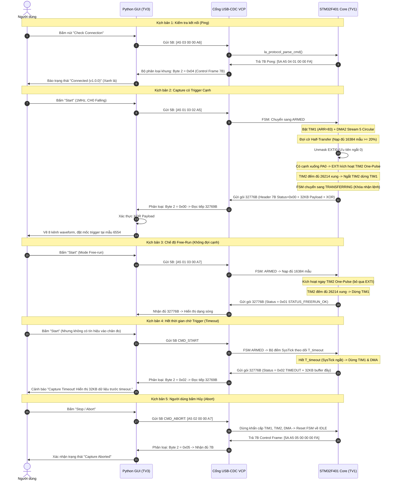

# Hợp đồng Giao thức Truyền thông (Communication Protocol Contract)
**Mã hiệu:** PROTOCOL-LA-2026 (Phiên bản v1.0.0)  
**Áp dụng:** Giao tiếp nhị phân giữa STM32F401 (Firmware - TV1) và Python Desktop GUI (Host PC - TV3) qua USB-CDC (Virtual COM Port).  
**Nguyên tắc cốt lõi:** Single Source of Truth (Nguồn sự thật duy nhất), đồng bộ hóa luồng byte chặt chẽ, phân loại khung dứt khoát và phân định trạng thái rõ ràng.

---

## 1. Khung Lệnh Điều khiển từ PC (Host -> Device: 5 Bytes)

Mọi lệnh gửi từ PC xuống STM32 đều có kích thước cố định đúng **5 Bytes**:

```text
+-----------+----------+----------+----------+----------+
|  Byte 0   |  Byte 1  |  Byte 2  |  Byte 3  |  Byte 4  |
+-----------+----------+----------+----------+----------+
|   0xA5    |  CMD_ID  | RATE_IDX | TRIG_CFG | CHECKSUM |
+-----------+----------+----------+----------+----------+
```

### 1.1. Chi tiết các trường dữ liệu
1. **Byte 0 (Magic Header):** Cố định giá trị `0xA5`. Dùng để định vị đầu khung lệnh.
2. **Byte 1 (CMD_ID):**
   * `0x01`: **CMD_START** - Bắt đầu quá trình thu thập tín hiệu logic.
   * `0x02`: **CMD_ABORT** - Hủy bỏ tức thì quá trình capture đang chạy, đưa FSM về `IDLE`.
   * `0x03`: **CMD_PING** - Kiểm tra kết nối và độ sẵn sàng của thiết bị.
3. **Byte 2 (RATE_IDX):** Chọn tần số lấy mẫu (Chỉ có hiệu lực khi `CMD_ID = 0x01`):
   * `0`: 6 MHz (ARR = 13)
   * `1`: 3 MHz (ARR = 27)
   * `2`: 2 MHz (ARR = 41)
   * `3`: 1 MHz (ARR = 83)
   * `4`: 500 kHz (ARR = 167)
   * `5`: 200 kHz (ARR = 419)
   * `6`: 100 kHz (ARR = 839)
   * `7`: 50 kHz (ARR = 1679)
   * `8`: 10 kHz (ARR = 8399)
   *(Nếu RATE_IDX > 8, lệnh bị từ chối bằng khung NAK `ERR_INVALID_RATE`).*
4. **Byte 3 (TRIG_CFG):** Cấu hình kích hoạt Trigger:
   * **4 bit cao `[7:4]` (Trigger Channel):** Kênh số `0` đến `7` (tương ứng chân PA0..PA7).
   * **4 bit thấp `[3:0]` (Trigger Mode):**
     * `0x0`: **Free-run Mode** (Bỏ qua trigger cạnh, thu thập đầy bộ đệm rồi dừng).
     * `0x1`: **Rising Edge** (Kích hoạt khi có cạnh lên trên kênh chỉ định).
     * `0x2`: **Falling Edge** (Kích hoạt khi có cạnh xuống trên kênh chỉ định).
5. **Byte 4 (CHECKSUM):** Byte kiểm tra tính toàn vẹn của lệnh:
   $$\text{CHECKSUM} = \text{Byte 0} \oplus \text{Byte 1} \oplus \text{Byte 2} \oplus \text{Byte 3}$$

### 1.2. Máy trạng thái nhận lệnh phía Firmware (Command Stream Assembler)
Do `CDC_Receive_FS()` có thể nhận dữ liệu phân mảnh thành từng byte:
* Firmware duy trì ring-buffer tích lũy dữ liệu.
* **Thuật toán quét trượt (Sliding Window):** Firmware tìm kiếm byte `0xA5`. Khi tìm thấy và bộ đệm có đủ 5 bytes, tính XOR Checksum.
* **Xử lý sai Checksum:** Nếu Checksum sai hoặc thông số ngoài dải, firmware gửi phản hồi NAK tương ứng, sau đó **chỉ loại bỏ đúng 1 byte `0xA5` đầu tiên** rồi tiếp tục quét tiếp (không xả sạch bộ đệm để không làm mất lệnh hợp lệ nối ngay phía sau).

---

## 2. Các Khung Dữ liệu Phản hồi từ STM32 (Device -> Host)

MCU phản hồi về PC bằng một trong hai loại khung cố định kích thước, phân biệt rõ ràng qua **Byte 2 (Status / RSP_CODE)**:

| Loại Khung | Kích thước | Giá trị Byte 2 (Status / RSP_CODE) | Mục đích |
| :--- | :--- | :--- | :--- |
| **Data Frame** | **32.776 Bytes** | `0x00`, `0x01`, `0x02` | Trả về 32KB dữ liệu mẫu sau chu trình Capture |
| **Control Frame** | **7 Bytes** | `0x04`, `0x05`, `0xE0` – `0xE3` | Phản hồi Ping, Abort hoặc báo lỗi NAK |

*(Lưu ý: Miền giá trị của Byte 2 hoàn toàn tách biệt: `0x00 – 0x02` dành riêng cho Data Frame; `0x04 – 0xFF` dành riêng cho Control Frame).*

---

### 2.1. Khung Phản hồi Dữ liệu Mẫu (Data Frame: 32.776 Bytes cố định)

```text
+-----------------------+-----------------------------+--------------------+
|  Header (7 Bytes)     |    Payload (32.768 Bytes)   |  Footer (1 Byte)   |
+-----------------------+-----------------------------+--------------------+
```

* **Header (7 Bytes):**
  * `Byte 0 – 1`: `0x5A, 0xA5` (Sync Magic Word - Little-Endian).
  * `Byte 2`: **Status Byte**
    * `0x00`: **STATUS_TRIGGER_OK** (Bắt được cạnh trigger và ghi đủ 80% post-trigger).
    * `0x01`: **STATUS_FREERUN_OK** (Chế độ Free-run nạp đầy 100% dung lượng bộ đệm).
    * `0x02`: **STATUS_TIMEOUT** (Hết thời gian $T_{\text{mcu\_timeout}}$ mà không có trigger, firmware tự dừng).
  * `Byte 3 – 4`: **`trig_offset`** = `6554` (uint16_t Little-Endian: `0x9A, 0x19`).
    *(Vị trí index của điểm trigger trong mảng 32KB; với Free-run mang tính tham khảo).*
  * `Byte 5 – 6`: **`sample_count`** = `32768` (uint16_t Little-Endian: `0x00, 0x80`).
* **Payload (32.768 Bytes):** 
  * Mảng dữ liệu mẫu được sắp xếp liên tục từ mẫu cũ nhất ($t_0$) đến mẫu mới nhất ($t_{32767}$).
  * *Quy tắc khi Timeout:* **Vẫn gửi trọn vẹn 32.768 Bytes**. Lý do: Với công thức timeout $T_{\text{mcu\_timeout}} = \frac{16384}{f_s} + 2.0\text{ s}$, thời gian này luôn lớn hơn thời gian nạp đầy toàn bộ bộ đệm $\frac{32768}{f_s}$ đối với mọi tần số $f_s \ge 8.2\text{ kHz}$ ($8.2\text{ kHz} \le 10\text{ kHz}$ - mức thấp nhất). Vì vậy khi timeout xảy ra, **bộ đệm 32KB luôn đầy 100% dữ liệu hợp lệ**, giúp người dùng quan sát được sóng trước sự kiện để tìm nguyên nhân không trigger.
* **Footer (1 Byte):** 
  * Byte kiểm tra XOR tính toán trên toàn bộ 32.768 bytes của phần Payload:
    $$\text{Footer} = \bigoplus_{i=0}^{32767} \text{Payload}[i]$$

---

### 2.2. Khung Phản hồi Điều khiển / Báo lỗi (Control Frame: 7 Bytes cố định)

```text
+-----------+-----------+----------+----------+----------+----------+----------+
|  Byte 0   |  Byte 1   |  Byte 2  |  Byte 3  |  Byte 4  |  Byte 5  |  Byte 6  |
+-----------+-----------+----------+----------+----------+----------+----------+
|   0x5A    |   0xA5    | RSP_CODE | ECHO_CMD | ECHO_DAT1| ECHO_DAT2| CHECKSUM |
+-----------+-----------+----------+----------+----------+----------+----------+
```

* `Byte 0 – 1`: `0x5A, 0xA5` (Sync Magic).
* `Byte 2 (RSP_CODE)`:
  * `0x04`: **RSP_PONG** - Phản hồi lệnh Ping thành công (Bytes 3–5 là Version Firmware: `0x01, 0x00, 0x00` $\implies$ v1.0.0).
  * `0x05`: **RSP_ABORTED** - Phản hồi xác nhận lệnh Abort thành công (Bytes 3–5 là `0x00, 0x00, 0x00`). Áp dụng cả khi đang capture dở hoặc khi MCU đang ở `IDLE`.
  * `0xE0`: **ERR_CHECKSUM** - Sai checksum của lệnh 5B.
  * `0xE1`: **ERR_INVALID_RATE** - RATE_IDX vượt quá 8.
  * `0xE2`: **ERR_INVALID_TRIG** - Kênh trigger $> 7$ hoặc mode trigger không hợp lệ.
  * `0xE3`: **ERR_BUSY** - MCU đang trong chu trình Capture, từ chối lệnh Start mới (yêu cầu gửi Abort trước).
* `Byte 3 – 5 (Echo Fields)`: Đối với các mã lỗi `0xE0 – 0xE3`, lặp lại nguyên văn 3 byte thông số của lệnh bị lỗi: `Byte 3 = CMD_ID`, `Byte 4 = RATE_IDX`, `Byte 5 = TRIG_CFG` để PC chẩn đoán.
* `Byte 6 (CHECKSUM)`: XOR Checksum của 6 bytes trước đó:
  $$\text{Byte 6} = \bigoplus_{i=0}^{5} \text{Byte}[i]$$

---

## 3. Sơ đồ Trình tự Hoạt động Toàn diện (Mermaid Sequence Diagram)



---

## 4. Xử lý Ngoại lệ, Đồng bộ & Quy tắc Khóa Lệnh (Robustness & Edge Cases)

### 4.1. Quy tắc Phân loại Khung phía GUI (Host Frame Dispatcher)
Để không bị treo khi nhận các khung 7B (PONG, ABORT, NAK), GUI triển khai bộ đọc theo thuật toán:
1. Đọc luồng byte từ cổng serial, tìm kiếm cặp đồng bộ `0x5A, 0xA5`.
2. Đọc tiếp 5 bytes để gom đủ **7 bytes đầu tiên**.
3. **Kiểm tra Byte 2 (Status / RSP_CODE):**
   * Nếu Byte 2 $\in \{0x00, 0x01, 0x02\}$ **VÀ** Byte 5–6 khớp `0x00, 0x80` ($32768$): Xác định là **Data Frame**. GUI đọc tiếp chính xác $32776 - 7 = \mathbf{32769\text{ Bytes}}$ (32.768B Payload + 1B Footer XOR) rồi tiến hành kiểm tra checksum toàn gói.
   * Nếu Byte 2 $\in \{0x04, 0x05, 0xE0, 0xE1, 0xE2, 0xE3\}$: Xác định là **Control Frame (7 Bytes)**. GUI kiểm tra XOR của 7 bytes này và kết thúc lượt đọc ngay lập tức.
   * Nếu Byte 2 không thuộc hai tập trên: Dữ liệu bị nhiễu/lệch, dịch con trỏ qua vị trí `0x5A, 0xA5` hiện tại 1 byte và tiếp tục quét trượt.

### 4.2. Khóa Lệnh khi đang Truyền Dữ liệu (State Locking)
* **Quy tắc tuyệt đối:** Khi FSM ở trạng thái **`TRANSFERRING`** (đang đẩy 32.776B qua USB-CDC):
  * **Phía MCU:** Bỏ qua hoàn toàn mọi byte nhận được từ cổng USB. Không bao giờ phát sinh khung NAK hay PONG chen ngang vào giữa dòng dữ liệu 32KB.
  * **Phía GUI:** Bị khóa giao diện, cấm gửi bất kỳ lệnh nào (kể cả Ping hay Start) cho đến khi hoàn tất việc nhận trọn vẹn 32.776 bytes hoặc sau khi quá hạn $T_{\text{gui\_timeout}}$.
* Lệnh `CMD_PING` và `CMD_ABORT` chỉ được xử lý khi FSM ở `IDLE`, `ARMED` hoặc `SAMPLING`.

### 4.3. Quy tắc Thời gian Chờ (Timeout Budget)
* **Phía MCU ($T_{\text{mcu\_timeout}}$):**
  $$T_{\text{mcu\_timeout}} = \frac{16384}{f_s} + T_{\text{wait}}$$
  * Trong phiên bản v1.0.0, **$T_{\text{wait}} = 2.0\text{ s}$ cố định**.
  * Định thời thực hiện bằng biến đếm mili-giây trong trình phục vụ ngắt `SysTick_Handler()`.
* **Phía GUI Serial ($T_{\text{gui\_timeout}}$):**
  $$T_{\text{gui\_timeout}} = T_{\text{mcu\_timeout}} + 1.5\text{ s}$$
  *(GUI luôn cộng thêm $1.5\text{ s}$ dự phòng độ trễ USB để không bao giờ ngắt kết nối trước MCU).*

### 4.4. Bảo vệ Chống Treo Cáp USB (`TxState` Watchdog)
* Khi gọi `CDC_Transmit_FS()` cho từng khối block 512B:
  * Firmware khởi động một biến đếm watchdog $100\text{ ms}$ cho mỗi block.
  * Nếu quá $100\text{ ms}$ mà cờ `hcdc->TxState` không trở về `0` (do người dùng rút cáp USB hoặc phần mềm GUI đóng cổng COM đột ngột): Firmware lập tức hủy chu trình truyền, cưỡng bức reset `hcdc->TxState = 0`, giải phóng bộ đệm và đưa FSM về `IDLE`.

---

## 5. Dữ liệu Mẫu & Vector Kiểm thử (Test Vectors cho TV3)

### 5.1. Bảng Khung Lệnh Mẫu Chuẩn (Host -> Device)
* **Start 1 MHz, Trigger Kênh 0 Falling (Chuẩn kịch bản test):**
  `A5 01 03 02 A5`  
  *(Kiểm tra: $0xA5 \oplus 0x01 \oplus 0x03 \oplus 0x02 = 0xA5$)*.
* **Start 6 MHz, Trigger Kênh 0 Rising:**
  `A5 01 00 01 A5`  
  *(Kiểm tra: $0xA5 \oplus 0x01 \oplus 0x00 \oplus 0x01 = 0xA5$)*.
* **Start 1 MHz, Free-run:**
  `A5 01 03 00 A7`  
  *(Kiểm tra: $0xA5 \oplus 0x01 \oplus 0x03 \oplus 0x00 = 0xA7$)*.
* **Ping:**
  `A5 03 00 00 A6`
* **Abort:**
  `A5 02 00 00 A7`

### 5.2. Bảng Khung Phản hồi Mẫu Chuẩn (Device -> Host)
* **PONG (v1.0.0):**
  `5A A5 04 01 00 00 FA`  
  *(Kiểm tra: $0x5A \oplus 0xA5 \oplus 0x04 \oplus 0x01 \oplus 0x00 \oplus 0x00 = 0xFA$)*.
* **ABORT ACK:**
  `5A A5 05 00 00 00 FA`  
  *(Kiểm tra: $0x5A \oplus 0xA5 \oplus 0x05 \oplus 0x00 \oplus 0x00 \oplus 0x00 = 0xFA$)*.
* **NAK Sai Checksum (Lệnh gửi A5 01 00 01 00):**
  `5A A5 E0 01 00 01 1B`  
  *(Echo lại CMD=01, RATE=00, TRIG=01; Checksum = $0x5A \oplus 0xA5 \oplus 0xE0 \oplus 0x01 \oplus 0x00 \oplus 0x01 = 0x1B$)*.

### 5.3. Cấu trúc Tệp Dữ liệu Giả lập `software/tests/sample_data_1mhz.bin`
Tệp nhị phân giả lập đúng **32.776 Bytes** phục vụ TV3 kiểm thử GUI độc lập:
* **Tần số giả lập:** **$1\text{ MHz}$** (ghi rõ trong tên tệp và metadata).
* **7 Bytes Header:** `5A A5 00 9A 19 00 80` (Magic `5A A5`, Status `00` OK, trig_offset `6554`, sample_count `32768`).
* **32.768 Bytes Payload:**
  * **Kênh 1 – 7:** Cố định mức logic 0 (`0x00`).
  * **Kênh 0 (PA0):** Tín hiệu UART TX chuẩn 115.200 bps:
    * Trạng thái nghỉ (Idle) của UART: Mức cao (Bit 0 của các byte = `1`).
    * **Start bit đầu tiên:** Cạnh xuống (Falling edge) từ `1` về `0` được đặt **chính xác tại mẫu index 6554** để khớp hoàn hảo với vạch trigger của GUI.
    * Nội dung ký tự truyền: Chuỗi `"TEST_LA_2026\r\n"`.
    * Độ rộng mỗi bit UART tại 1 MHz: $\frac{1.000.000}{115.200} \approx 8.68\text{ mẫu}$.
* **1 Byte Footer:** Byte XOR của toàn bộ 32KB payload.
